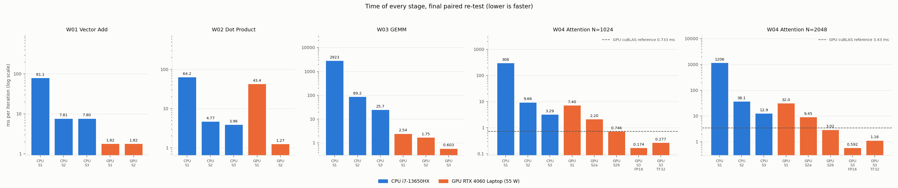
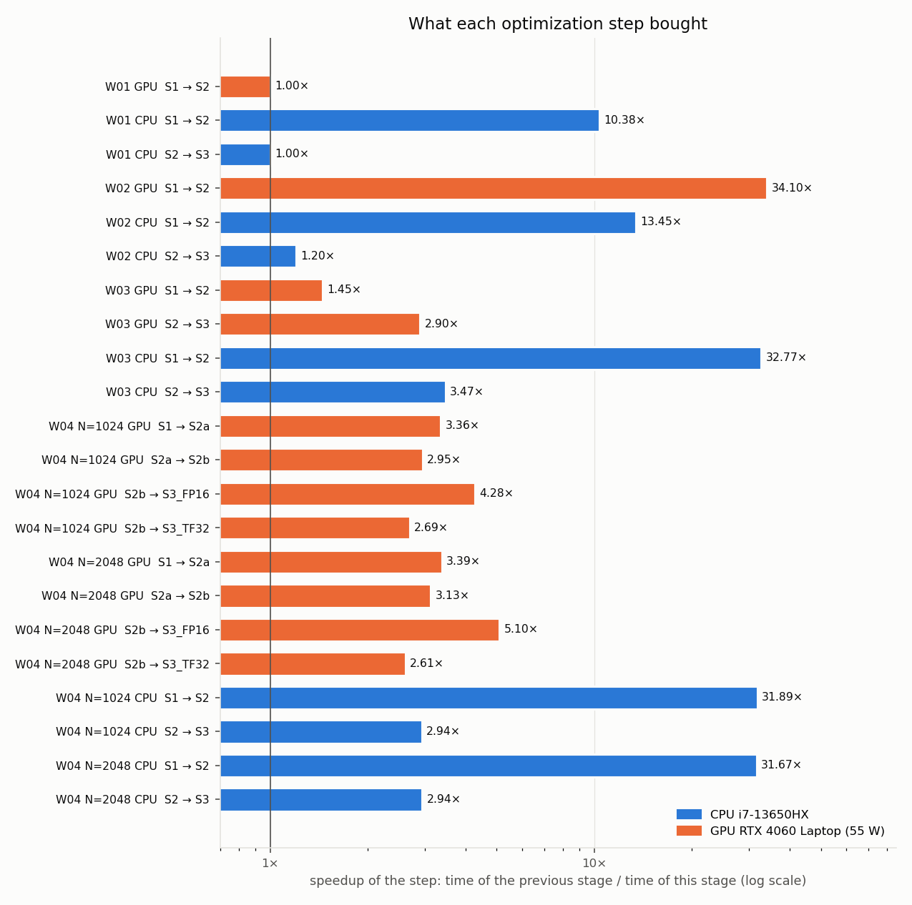
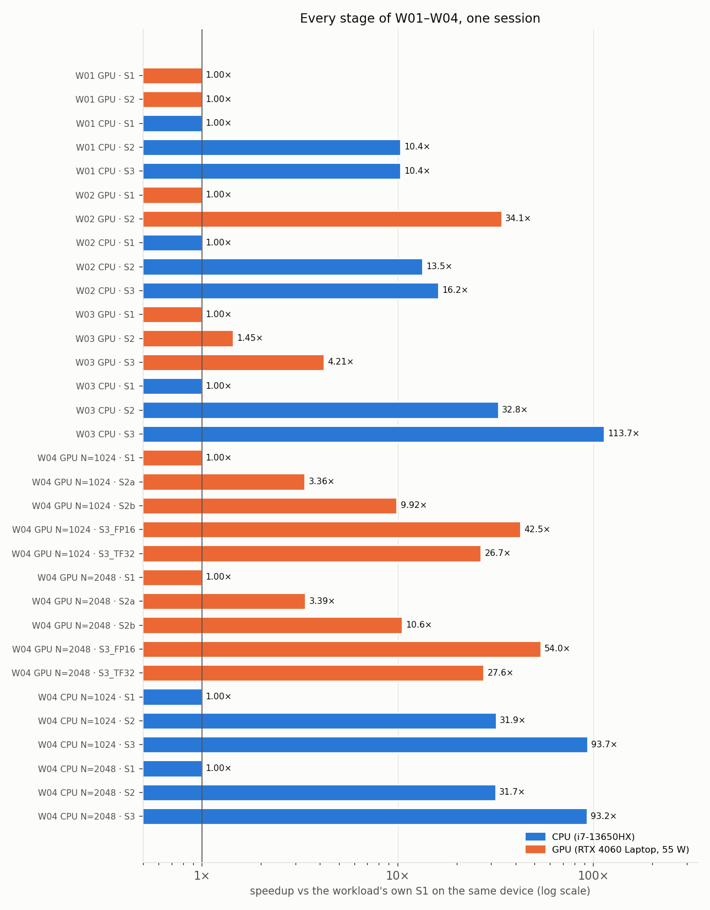
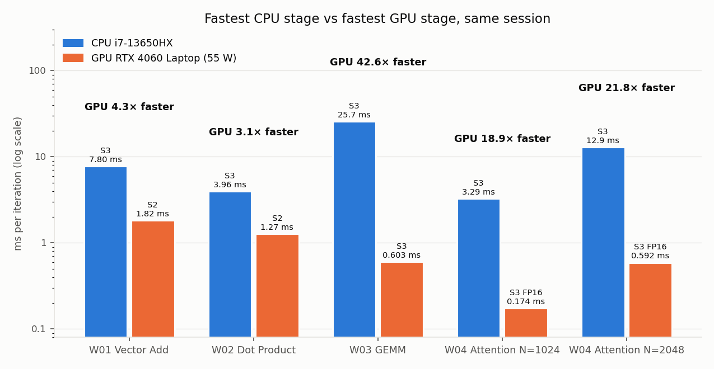
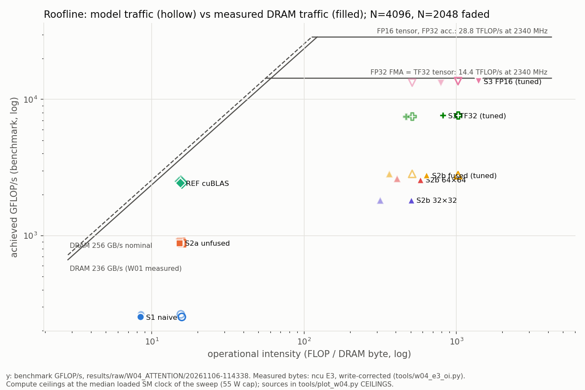
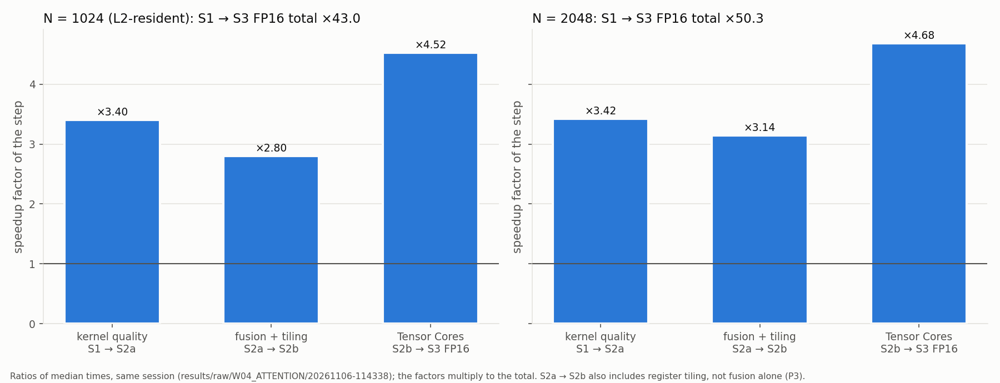
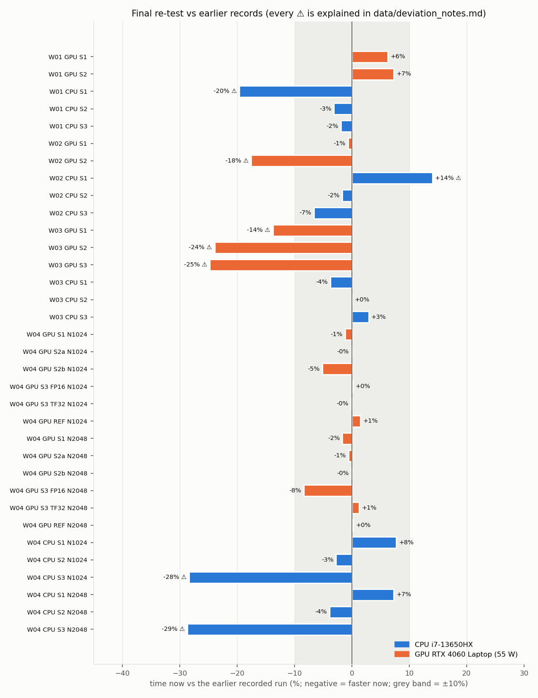

# Complete Brief — CPU vs GPU Performance: Profiling and Optimization

*Final state: 6 November 2026. Final measurements: run `20261106-141652` (commit `5b61fa3`). Every number below is measured on the one machine in §3 unless it is labelled otherwise.*

---

## 1. Definition — what this project is

A benchmarking and profiling study of **how a laptop CPU and a laptop GPU execute four workloads**, and of **how much each optimization step helps, and why**.

Each workload is implemented as a ladder of stages:

| Stage | Name | Meaning |
|---|---|---|
| **S1** | BASE | the simplest correct implementation (the baseline) |
| **S2** | SWOPT | software optimization: parallelism, tiling, coalescing, better reductions, kernel fusion |
| **S3** | HWACC | architecture-specific hardware: AVX2/FMA vector units on the CPU, Tensor Cores on the GPU |

Every stage is (1) checked for correctness against a double-precision reference, (2) timed with one fixed protocol, and (3) explained with a hardware counter, a profiler metric, or the machine code. A faster number without an explanation does not count as a result.

File, binary and CSV names follow one convention: `<WID>_<WORKLOAD>_<CPU|GPU>_<S#>_<BASE|SWOPT|HWACC>_<VARIANT>`, for example `W04_ATTENTION_GPU_S2b_SWOPT_FUSED`.

## 2. Goals and objectives

**Goals**
1. Show, with measurements, what limits each workload: memory bandwidth, reductions, compute, or memory traffic between kernels.
2. Quantify every optimization step separately, so that a total speedup can be read as a product of factors with a known cause each.
3. Compare the CPU and the GPU on the same problems, on the same day, under the same protocol.
4. Make every result reproducible from the public repository with one command.

**Objectives (concrete, checkable)**
| # | Objective | Status |
|---|---|---|
| O1 | Four workloads with increasing operational intensity (W01 0.083 → W04 ~360 FLOP/B fused) | done |
| O2 | S1/S2/S3 on CPU and GPU for every workload (W04 GPU with S2a/S2b and S3 FP16/TF32 variants) | done: 34 stage configurations |
| O3 | Every stage passes a correctness check against double precision | done: **34/34 Correct YES** in the final run |
| O4 | One measurement protocol, paired runs in one session | done: `scripts/run_all.sh` |
| O5 | Every speedup explained by a counter (Nsight Compute, Nsight Systems, VTune, `perf`) or SASS/assembly | done for W01–W04; W04 hypotheses H1–H4 decided by pre-registered rules |
| O6 | W04: separate the effect of fusion from the effect of better kernels | done: fusion alone 1.15×, register tiling 2.74× |
| O7 | A public repository whose README commands work from a fresh clone | done: verified from a fresh public tree, published |

## 3. Hardware, software and method

| | |
|---|---|
| CPU | Intel Core i7-13650HX: 6 P-cores + 8 E-cores, 20 threads, AVX2 + FMA (no AVX-512); P-core L1d 48 KiB, L2 1.25 MiB; L3 24 MiB |
| GPU | NVIDIA GeForce RTX 4060 Laptop: Ada sm_89, 24 SMs, 8 GiB GDDR6, 128-bit bus (256 GB/s nominal), 32 MiB L2, Tensor Cores; default power limit 55 W |
| Software | Ubuntu 24.04, g++ 13.3, CUDA 13.4, driver 595.99, Nsight Compute / Systems 2026.3, VTune 2026 |

**Measurement protocol (every stage):** 2 warm-up iterations, 20 timed iterations, 5 repetitions; mean ± SD per iteration. GPU timing uses CUDA events, CPU timing `std::chrono::steady_clock`. In the final run, GPU stages ran in **3 interleaved rounds** with the order rotated each round, and the result is the median of the round means. CPU stages waited for the package to cool to ≤ 70 °C before each run. GPU clocks, power and temperature were logged every 250 ms; CPU temperature and frequency were sampled every 0.2 s. Threads were pinned (`OMP_PROC_BIND=close OMP_PLACES=cores`): 6 threads for W01/W02, 8 for W03, 20 for W04.

**Correctness rule:** each binary compares its output with a double-precision reference and reports YES/NO. Tolerances were fixed in advance and never loosened: W02 relative error ≤ 0.1%; W03 ≤ 0.1%; W04 ≤ 1e-4 (FP32), 5e-3 (TF32), 1e-2 (FP16), plus a large-logits input that breaks an unstable softmax.

**Profilers explain, benchmarks measure:** profiler runs replay kernels at fixed clocks, so their durations are never used as speedups.

## 4. The four workloads

| ID | Operation | Size (final run) | Operational intensity | What it stresses | CPU ladder | GPU ladder |
|---|---|---|---|---|---|---|
| **W01 Vector Add** | `C = A + B` | N = 33,554,432 floats | 0.083 FLOP/B | memory bandwidth | scalar -O0 → OpenMP (-O3) → OpenMP + AVX2 | naive (256 threads/block) → coalesced (128) |
| **W02 Dot Product** | `s = Σ aᵢbᵢ` | N = 33,554,432 | 0.25 FLOP/B | reductions | scalar → OpenMP → OpenMP + AVX2/FMA | naive (one atomic address) → hierarchical block reduction |
| **W03 GEMM** | `C = A × B` (FP32) | N = 1024 | 170.7 FLOP/B | compute + data reuse | naive triple loop → 128×128 cache-blocked + OpenMP → + AVX2/FMA | naive → 16×16 shared-memory tile → TF32 Tensor Cores (WMMA) |
| **W04 Attention** | `O = softmax(QKᵀ/√d)·V` | BH = 8, d = 64, N = 1024 and 2048 | unfused ~15, fused ~360–480 FLOP/B (measured DRAM bytes) | memory traffic between kernels, fusion | scalar → fused + blocked + OpenMP → + AVX2/FMA and a vector `exp` | naive (3 kernels) → S2a tiled, unfused (3 kernels) → S2b fused, FlashAttention-style (1 kernel) → S3 FP16 / TF32 Tensor Cores; reference: cuBLAS GEMMs + softmax |

W01–W03 each show one behaviour (memory-bound, reduction-bound, compute-bound). W04 combines all three. Its new lesson is **fusion**: the unfused version writes the N×N score matrix to DRAM and reads it back, while the fused version keeps tiles of it on chip.

## 5. What was done

| Phase | Work | Key outcome |
|---|---|---|
| W01–W03 (Oct 2026) | S1–S3 on CPU and GPU, VTune and Nsight Compute profiles, analysis | W01 memory-bound; W02 reduction structure; W03 data reuse + Tensor Cores (`HMMA.1684.F32.TF32` verified in SASS) |
| W04 P0 | one named-flag CLI, double-precision reference, CSV writer, correctness test | 215 automatic checks, including large-logits stability |
| W04 P1 | CPU S1–S3, compiler-flag study, 1–20 thread sweep, tile choice (temperature-logged rerun) | S1→S3 ~62× at N=1024 in that session; tiles S2 64×64, S3 32×64 |
| W04 P2 | GPU S1, S2a unfused, cuBLAS reference | S1→S2a 3.3–4.3×; S2a 31–38% of the reference |
| W04 P3 | GPU S2b fused FlashAttention-2-style kernel (online softmax) | 21–42× fewer DRAM bytes; peak memory linear in N |
| W04 P4 | GPU S3 Tensor Cores, FP16 and TF32 from one template | FP16 5.0–5.2×, TF32 1.7–1.8× over S2b |
| W04 P5 | autotuning of tile × warps (45 configurations per N); GPU fast-math study | S2b 64×32 with 4 warps (1.5–1.6× the old default); fast-math +1–5%, not adopted |
| W04 P6 | profiling E3–E8 (DRAM bytes, stall reasons, launch gaps, CPU counters), hypotheses H1–H4, plots; follow-up: TF32 fragment-load fix (1.2–1.35×), equal-clock check | verdicts in §6.4 |
| W04 P7 | live demo kit: race of all stages, live Nsight Compute fusion comparison | live fusion: 31× fewer DRAM bytes, fusion alone 1.16× |
| **P8** | **final paired re-test of W01–W04 in one session**, consolidated results, release README v1.0 | 34/34 correct; three fixes found and made on the way (§8) |

## 6. Results (final run `20261106-141652`)

### 6.1 Every stage



| Workload | Device | Stage | ms (mean ± SD) | rate | × vs S1 | × vs previous | time saved |
|---|---|---|---|---|---|---|---|
| W01 | GPU | S1 naive | 1.824 ± 0.003 | 221 GB/s | 1.00 | – | – |
| | GPU | S2 coalesced | 1.823 ± 0.003 | 221 GB/s | **1.00** | 1.00 | 0.0% |
| | CPU | S1 scalar | 81.05 ± 0.12 | 5.0 GB/s | 1.00 | – | – |
| | CPU | S2 OpenMP, 6 thr. | 7.81 ± 0.13 | 51.6 GB/s | 10.38 | 10.38 | 90.4% |
| | CPU | S3 + AVX2 | 7.80 ± 0.02 | 51.6 GB/s | **10.39** | 1.00 | 90.4% |
| W02 | GPU | S1 naive atomics | 43.42 ± 0.01 | 6.2 GB/s | 1.00 | – | – |
| | GPU | S2 block reduction | 1.274 ± 0.03 | 212 GB/s | **34.10** | 34.10 | 97.1% |
| | CPU | S1 scalar | 64.16 ± 0.21 | 4.2 GB/s | 1.00 | – | – |
| | CPU | S2 OpenMP, 6 thr. | 4.77 ± 0.02 | 56.3 GB/s | 13.45 | 13.45 | 92.6% |
| | CPU | S3 + AVX2/FMA | 3.96 ± 0.04 | 67.8 GB/s | **16.20** | 1.20 | 93.8% |
| W03 | GPU | S1 naive | 2.537 ± 0.19 | 846 GFLOP/s | 1.00 | – | – |
| | GPU | S2 shared tile | 1.750 ± 0.11 | 1227 GFLOP/s | 1.45 | 1.45 | 31.0% |
| | GPU | S3 TF32 Tensor Cores | 0.603 ± 0.04 | 3559 GFLOP/s | **4.21** | 2.90 | 76.2% |
| | CPU | S1 naive | 2922.6 ± 5.2 | 0.73 GFLOP/s | 1.00 | – | – |
| | CPU | S2 blocked + OpenMP, 8 thr. | 89.19 ± 0.11 | 24.1 GFLOP/s | 32.77 | 32.77 | 96.9% |
| | CPU | S3 + AVX2/FMA | 25.70 ± 0.02 | 83.6 GFLOP/s | **113.7** | 3.47 | 99.1% |
| W04 N=2048 | GPU | S1 naive | 31.99 ± 0.09 | 268 GFLOP/s | 1.00 | – | – |
| | GPU | S2a tiled, unfused | 9.447 ± 0.20 | 910 GFLOP/s | 3.39 | 3.39 | 70.5% |
| | GPU | S2b fused | 3.022 ± 0.10 | 2845 GFLOP/s | 10.59 | 3.13 | 90.6% |
| | GPU | S3 FP16 Tensor Cores | 0.592 ± 0.01 | 14,501 GFLOP/s | **54.01** | 5.10 | 98.1% |
| | GPU | S3 TF32 Tensor Cores | 1.158 ± 0.10 | 7470 GFLOP/s | 27.63 | 2.61 (vs S2b) | 96.4% |
| | GPU | REF cuBLAS (reference) | 3.430 ± 0.26 | 2507 GFLOP/s | 9.33 | – | – |
| | CPU | S1 scalar | 1205.6 ± 1.2 | 7.1 GFLOP/s | 1.00 | – | – |
| | CPU | S2 fused + blocked + OpenMP, 20 thr. | 38.06 ± 0.68 | 226 GFLOP/s | 31.67 | 31.67 | 96.8% |
| | CPU | S3 + AVX2/FMA + vector exp | 12.94 ± 0.29 | 664 GFLOP/s | **93.18** | 2.94 | 98.9% |

W04 at N = 1024 (full table in `data/RESULTS_SUMMARY.md`): GPU 7.400 → 0.174 ms (S3 FP16, 42.5×); CPU 308.0 → 3.29 ms (93.7×).

### 6.2 What each optimization step bought





### 6.3 CPU vs GPU (same session, same N)



| Workload | CPU S1 → GPU S1 | best CPU → best GPU | CPU S1 → best GPU |
|---|---|---|---|
| W01 Vector Add | 44.4× | S3 7.80 → S2 1.82 ms: **4.3×** | 44× |
| W02 Dot Product | 1.5× | S3 3.96 → S2 1.27 ms: **3.1×** | 50× |
| W03 GEMM | 1152× | S3 25.7 → S3 0.603 ms: **42.6×** | 4844× |
| W04 Attention N=1024 | 41.6× | S3 3.29 → S3 FP16 0.174 ms: **18.9×** | 1768× |
| W04 Attention N=2048 | 37.7× | S3 12.9 → S3 FP16 0.592 ms: **21.8×** | 2035× |

The GPU advantage grows with operational intensity. On memory-bound W01/W02 it equals the ratio of memory bandwidths (GPU ~220 GB/s vs CPU ~52–68 GB/s, 3–4×). On compute-bound W03/W04 it reaches 19–43×, because the GPU's Tensor Cores and many SMs can be fed from on-chip memory.

### 6.4 Why — the explanation behind each result

| Workload | Result | Explanation (evidence) |
|---|---|---|
| W01 GPU | S2 = S1 (1.00×) | Both kernels stream 221 GB/s, 86% of the 256 GB/s nominal DRAM bandwidth (Nsight Compute: DRAM ~90% busy, SMs nearly idle). A memory-bound kernel cannot be sped up by better code. **Time follows the memory clock exactly**: at 7001 MHz S1 took 2.065 ms, at 8001 MHz 1.824 ms (ratio 0.874 vs 0.875). |
| W01 CPU | threads 10.4×, AVX2 1.00× | 6 threads already reach 52 GB/s, the practical DRAM limit of the CPU, so wider vectors cannot help. |
| W02 GPU | 34× | S1 serializes millions of atomics on one address. The block reduction keeps every SM busy and streams 212 GB/s. |
| W02 CPU | threads 13.5×, FMA 1.20× | Threads add bandwidth; FMA helps only a little because the loop is bandwidth-limited. |
| W03 GPU | tile 1.45×, Tensor Cores 2.9× | Shared-memory reuse cuts global loads. The TF32 Tensor Core kernel uses `HMMA.1684.F32.TF32` (SASS), with 56 registers per thread, which caps occupancy at 75%. |
| W03 CPU | blocking + threads 32.8×, FMA 3.5× | 128×128 tiles reuse data from cache; 8-wide FMA multiplies the FLOP rate. |
| W04 GPU S1 → S2a | 3.39× | **H1 rejected:** the naive time is not dominated by S/P traffic. The QKᵀ kernel takes 65% of S1, is L1-bound (99.7% L1/TEX) at 2.5% of DRAM bandwidth, with uncoalesced K loads (9 sectors per request instead of 4). |
| W04 GPU S2a → S2b | 3.13× = fusion 1.15× · register tiling 2.74× | Fusion removes 24–31× of the DRAM bytes (S2a ~562 MB → S2b ~18–24 MB per pass at N=2048), but S2a's GEMMs were not DRAM-bound either; only its softmax was (86% of DRAM peak). **H2 partly supported:** bytes saved grow with N (23.7× → 41×), the time saved by fusion alone stays flat after the matrix leaves L2 (1.03 → 1.15 → 1.16×). |
| W04 GPU S2b → S3 | FP16 5.10×, TF32 2.61× | Both inner GEMMs on Tensor Cores. **H3 partly supported:** the tensor pipe is only 22% busy and `exp` 6%. The kernel is latency-bound at 2 warps per scheduler. TF32 runs at half the Tensor Core rate with half the occupancy. |
| W04 GPU S2b vs REF | 1.13× faster at the 55 W cap | Only at the laptop's power limit. At a locked 1500 MHz SM clock the reference is 1.29× faster: it is memory-bound and barely clock-sensitive, while S2b is compute-bound. |
| W04 CPU | fusion + blocking + threads 31.7×, AVX2 2.94× | **H4 not supported (both halves):** L2 misses stay rare (≤ 0.016 per 1000 instructions) even when K/V outgrow L2; `exp` is 17% of S2's time, so the vector `exp` is not the main gain. S3's gain comes from 256-bit FMA and 4.5× fewer instructions. |
| W04 launch overhead | ~0.7 µs per kernel | Nsight Systems: the GPU idles 0.6–0.8 µs between queued kernels; 0.37% of S2a at N=512, negligible above. |

The measured-traffic Roofline for W04 (fusion moves points right, Tensor Cores move them up):





## 7. Comparison with earlier records



26 of 34 stages are within ±10% of the earlier recorded runs. The 8 outside are each explained in `data/deviation_notes.md`:

| Stage | Δ | Reason |
|---|---|---|
| W02 CPU S1 | +14% | different computation by design: double accumulator (§8) |
| W04 CPU S3 (N=1024, 2048) | −28%, −29% | the earlier reference was a thermally loaded session; a temperature-logged rerun the same evening gave 3.45 ms, within 5% of today |
| W01 CPU S1 | −20% | same flags and source; the old binary is just as fast today, so it is a session difference (earlier records themselves range 100.8–123.6 ms) |
| W02 GPU S2, W03 GPU S1/S2/S3 | −14% to −25% | the earlier values are single October rows with no clock or driver log; today's values repeat across 3 rounds and 2 other sessions, and the numerical results are identical. Not attributable; kept as an open issue |

**W01 reconciliation:** earlier records disagreed: a 35.1 ms single row (11 GB/s, not a DRAM-limited run), per-repetition rows of 1.715 / 1.699 ms, and console lines of 2.011 / 1.779 ms. The final value, from 3 rounds × 5 repetitions of CSV rows, all at 8001 MHz memory clock, is **S1 1.824 ms, S2 1.823 ms, ratio 1.000×**.

## 8. Problems found and fixed during the final re-test

| Problem | Effect | Fix |
|---|---|---|
| W01 GPU S1 was compiled without sm_89 code | did not run on this driver ("PTX compiled with an unsupported toolchain") | `-gencode arch=compute_89,code=sm_89` in the Makefile |
| W02 S1 (CPU and GPU) and CPU S2 accumulated in FP32 | 6.75%, 6.8% and 0.41% off the true sum. Each stage used a different check: GPU S1 passed against an FP32 sum with the same error; CPU S2/S3 only checked that the result was finite | double accumulators (FP32 inputs) and one check for every W02 stage: ≤ 0.1% vs double. All now pass (errors ≤ 0.02%) |
| W02 CPU S1 CSV rows had 19 fields under a 21-column header | missing reference and error columns | row writer fixed |
| W01 CPU S2/S3 were built at -O0 | 2.5× slower than the recorded -O3 results | Makefile and CSV flag strings set to the -O3 flags the recorded binaries used (read from their debug info) |
| Short GPU runs could start at the lower memory clock | W01 S1 14% slower than S2 in the first full run | untimed priming run before each W01–W03 GPU stage; the memory clock of every run is recorded |

## 9. Limitations

**General**
- **One machine.** One laptop, one driver, one compiler version. Other hardware gives other ratios.
- **Laptop clocks and power.** The GPU runs at its 55 W default power limit, so each stage runs at its own SM clock (1600–2700 MHz). GPU stage ratios are at equal power, not equal clock. Ratios against the memory-bound cuBLAS reference change by ~30% at a locked clock. Memory-bound stages follow the memory clock (7001 or 8001 MHz). The CPU runs at 72–96 °C under load; long CPU sessions can differ by up to ~24%. Clocks were not locked (that needs root).
- **Nominal Roofline ceilings.** Peak bandwidth and FLOP rates are vendor nominal values or derived from the measured clock, not measured with a microbenchmark.
- **Profiler replay.** Nsight Compute replays kernels with flushed caches at base clock. Its byte counts are reliable; its durations are not benchmark times. DRAM writes are a lower bound (dirty L2 lines at kernel end are not counted).
- **Earlier October records** for W02 GPU S2, W03 GPU and W01 CPU S1 could not be reproduced within 10%, and their causes cannot be established after the fact.

**Per workload**
| Workload | Limitation |
|---|---|
| W01 | memory-bound by design: no stage can beat the bandwidth limit; S3 adds nothing on this CPU |
| W02 | S1/S2 use double accumulators since P8, so their times are not comparable with the October FP32 records; the GPU S1 baseline is atomics-bound, which inflates the S2 speedup |
| W03 | one size (N = 1024); TF32 S3 carries a 0.069% relative error (inside the 0.1% tolerance); occupancy capped at 75% by registers |
| W04 | forward pass only, non-causal, d = 64 fixed; the S3 kernel is latency-bound and leaves the tensor pipe 78% idle (asynchronous copies and a register-resident softmax were not tried); PyTorch SDPA and Triton comparisons (optional S4) not done |

## 10. Conclusions

1. **Know the bound first.** W01 cannot be optimized on the GPU, because it already runs at 86% of DRAM bandwidth. The same "optimization" that gives 34× on W02 gives 1.00× on W01.
2. **Speedups are products of causes.** W04 GPU 54× = 3.39 (better kernels) × 3.13 (fusion + register tiling) × 5.10 (Tensor Cores). Each factor is backed by a counter.
3. **Fewer bytes is not the same as less time.** Fusion removed ~96% of W04's DRAM traffic but saved only ~15% of the time by itself, because the unfused GEMMs were not DRAM-bound.
4. **The CPU–GPU gap depends on operational intensity:** 3–4× on memory-bound work, 19–43× on compute-bound work.
5. **Correctness checks must be uniform and against a true reference.** Three W02 stages passed checks that would not catch a 6.8% error; one rule against double precision exposed and fixed them.
6. **Measurement conditions matter as much as code.** A memory-clock state, a thermally loaded session, or a build flag each moved results by 14–150%. Only paired runs with logged clocks made those effects visible.

## 11. How to reproduce

```bash
git clone https://github.com/<you>/GPU-CPU-Performance-Profiling_and-Optimization.git
cd GPU-CPU-Performance-Profiling_and-Optimization
make legacy w04 && bash tests/test_w04_correctness.sh
bash scripts/run_all.sh            # every stage of W01–W04 in one session, ~25 min
python3 tools/final_summary.py results/raw/FINAL/<timestamp>
```
The graphs in `graphs/comparison/` are regenerated with `python3 "Comparison final/scripts/make_graphs.py"`.

## 12. What is in this folder

See `README.md` in this folder for the full index: data tables, every relevant run, profiler exports, and graphs.
