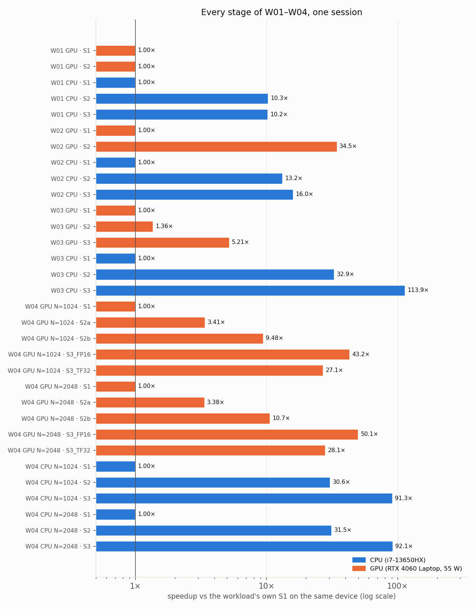
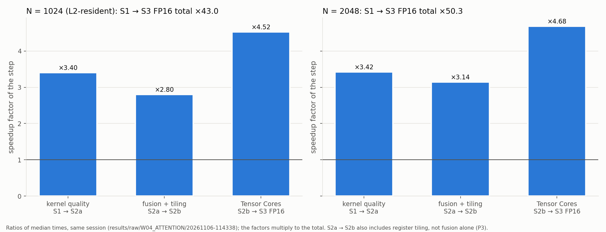
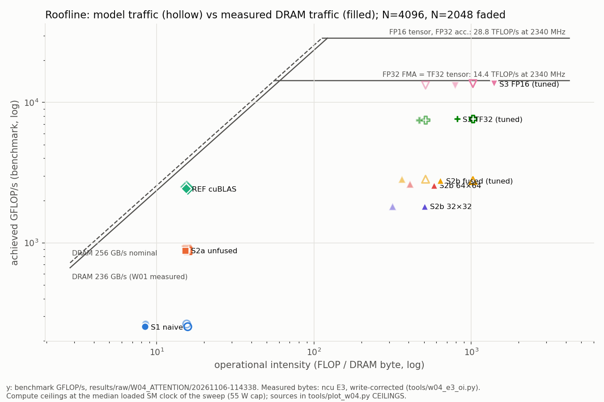

# CPU vs GPU Performance: Profiling and Optimization

How far does each optimization take a workload on a laptop CPU and GPU, and *why*?

This repo implements four workloads in progressively optimized stages. Each stage is benchmarked, checked against a double-precision reference, and explained with hardware profilers (NVIDIA Nsight Compute and Nsight Systems, Intel VTune, `perf`) and a Roofline model.

| | Hardware (the only machine measured) |
|---|---|
| CPU | Intel Core i7-13650HX: 6 P-cores + 8 E-cores, 20 threads, AVX2/FMA, 24 MiB L3 |
| GPU | NVIDIA GeForce RTX 4060 Laptop: Ada, sm_89, 24 SMs, 8 GiB GDDR6 (128-bit, 256 GB/s nominal), Tensor Cores, default 55 W power limit |
| Software | Ubuntu 24.04, g++ 13.3, CUDA 13.4, driver 595.99 |

## Workloads and optimization stages

Every workload follows the same ladder:
- **S1 Baseline:** the simplest correct code.
- **S2 Software optimization:** parallelism, tiling, coalescing, better reductions, fusion.
- **S3 Hardware acceleration:** AVX2/FMA on the CPU, Tensor Cores on the GPU.

| Workload | What it stresses | CPU stages | GPU stages |
|---|---|---|---|
| **W01 Vector Add** `C = A + B` | memory bandwidth | scalar → OpenMP → AVX2 | naive → coalesced |
| **W02 Dot Product** `s = Σ aᵢbᵢ` | reductions | scalar → OpenMP → AVX2/FMA | naive (atomics) → hierarchical block reduction |
| **W03 GEMM** `C = A × B` | compute + data reuse | naive → cache-blocked + OpenMP → AVX2/FMA | naive → shared-memory tiling → TF32 Tensor Cores |
| **W04 Attention** `softmax(QKᵀ/√d)·V` | memory traffic and kernel fusion | naive → fused + blocked + OpenMP → AVX2/FMA | naive → tiled (unfused) → fused FlashAttention-style → FP16 / TF32 Tensor Cores |

## Key results

All numbers are from **one session** (run `20261106-151143`, commit `7f0e5f6`) that re-ran every stage of W01–W04 with the same protocol: 2 warm-ups, 20 timed iterations, 5 repetitions, mean ± SD; GPU stages in 3 interleaved rounds (median of the round means). **All 34 stage runs passed their correctness check.** The full tables (± SD, GFLOP/s or GB/s, speedup per step, error against double precision, clocks, comparison with earlier runs) are in [`docs/RESULTS_SUMMARY.md`](docs/RESULTS_SUMMARY.md) and [`docs/results/final_results.csv`](docs/results/final_results.csv).

| Workload | Device | S1 → best stage | Speedup | Why |
|---|---|---|---|---|
| W01 Vector Add, N = 33.5 M | GPU | 1.796 → 1.796 ms (S2) | **1.00×** | Both kernels stream 224 GB/s, 88% of the 256 GB/s nominal DRAM bandwidth: memory-bound, so better code cannot help |
| | CPU | 79.9 → 7.82 ms (S3, 6 threads) | **10.2×** | All of it from threads (S2 10.3×); AVX2 adds nothing (0.99×) because 6 threads already reach 52 GB/s of DRAM bandwidth |
| W02 Dot Product, N = 33.5 M | GPU | 43.4 → 1.26 ms (S2) | **34.5×** | S1 serializes on one atomic address; the block reduction streams 214 GB/s |
| | CPU | 63.4 → 3.96 ms (S3, 6 threads) | **16.0×** | Threads 13.2×, then 8-wide FMA 1.21× (bandwidth-limited) |
| W03 GEMM, N = 1024 | GPU | 2.46 → 0.472 ms (S3) | **5.2×** | Shared-memory tiling 1.36×, then TF32 Tensor Cores 3.8× (`HMMA` verified in SASS; 32×32 k-tile 32 block, fragments loaded from shared memory) |
| | CPU | 2932 → 25.7 ms (S3, 8 threads) | **114×** | Cache blocking + threads 32.9×, then 8-wide FMA 3.5× |
| W04 Attention, N = 2048 | GPU | 32.1 → 0.640 ms (S3 FP16) | **50.1×** | Kernel quality 3.38× · fusion + register tiling 3.15× · FP16 Tensor Cores 4.70×; 13.5 TFLOP/s |
| | CPU | 1188 → 12.9 ms (S3, 20 threads) | **92.1×** | Fusion + blocking + threads 31.5×, then AVX2/FMA and a vector `exp` 2.93× |

**Complete comparison package:** [`Comparison final/`](Comparison%20final/README.md) holds the [Complete Brief](Comparison%20final/Complete%20Brief.md) (goals, method, results, explanations, limitations), every relevant run as CSV, the profiler exports, and comparison graphs.

CPU vs GPU in the same session: the best GPU stage is 4.3× (W01), 3.1× (W02), 54.5× (W03) and 20.1× (W04, N = 2048) faster than the best CPU stage.

W04 in more detail (N = 2048, GPU):
- The fused FP32 kernel (S2b, 3.01 ms) is 1.11× faster than a cuBLAS-based unfused reference (3.35 ms) at the laptop's 55 W power limit. That ratio depends on the clock: at an equal, locked SM clock the reference is faster, because it is memory-bound and the fused kernel is compute-bound.
- Fusion removes 24–31× of the DRAM traffic (Nsight Compute), but by itself it saves only ~15% of the time. Most of S2a → S2b is register tiling. S2a's GEMMs were not DRAM-bound either; only its softmax was.
- The FP16 Tensor Core kernel reaches 13.5 TFLOP/s and is latency-bound at 2 warps per scheduler: no execution unit is saturated.
- The development history (autotuning, profiling verdicts, TF32 fix) is in [`docs/results/W04_phase_results.md`](docs/results/W04_phase_results.md).

### Figures



*Every stage of W01–W04 as a speedup over the workload's own S1 on the same device (run `20261106-151143`).*



*W04 GPU speedup factored into kernel quality (S1 → S2a), fusion + register tiling (S2a → S2b) and Tensor Cores (S2b → S3), at N = 1024 and 2048 (GPU N sweep `20261106-114338`, 3 interleaved rounds; the final re-test agrees within 4% at N = 2048 and within 10% at N = 1024).*



*W04 Roofline with operational intensity from DRAM bytes measured by Nsight Compute. Fusion moves the points right (fewer bytes), Tensor Cores move them up. Same sweep as above; ceilings are nominal (see Limitations).*

## Status

| Phase | Content | State |
|---|---|---|
| W01–W03 | benchmarks, profiling, analysis | done |
| W04 P0–P6 | harness and reference, CPU S1–S3, GPU S1/S2a/REF, fused S2b, Tensor Core S3, autotuning, profiling | done ([phase log](docs/results/W04_phase_results.md)) |
| W04 P7 | live demo integration | done: [`demo_kit/`](demo_kit/README.md), runs from a clone |
| P8 | final paired re-test of W01–W04, consolidated results, release | done: 34/34 stages correct, [`docs/RESULTS_SUMMARY.md`](docs/RESULTS_SUMMARY.md) |
| After P8 | W03 GPU S3 kernel optimized (1.26× at N = 1024 in a paired A/B, correct at any N), demo kit runs from a clone, full re-test repeated | done: run `20261106-151143` |

## Requirements

- Linux (tested on Ubuntu 24.04)
- NVIDIA GPU with compute capability 8.9, or change `sm_89` in the Makefile
- CUDA Toolkit 12+ (`nvcc`, cuBLAS), `g++` with OpenMP, GNU `make`, Python 3
- Optional: matplotlib (figures); Nsight Compute, Nsight Systems, Intel VTune (profiling)

## Build and test

```bash
git clone https://github.com/Fe3w/GPU-CPU-Performance-Profiling_and-Optimization.git
cd GPU-CPU-Performance-Profiling_and-Optimization

make legacy w04                        # W01-W03 and W04 binaries, into build/
bash tests/test_w04_correctness.sh     # W04: every stage vs a double-precision reference (~1 min)
```

`make w01`, `make w02`, `make w03` and `make w04` build one workload each. Each binary is named after its source file (`build/W03_GEMM_GPU_S3_HWACC_TENSOR_CORE` from `src/gpu/W03_GEMM/W03_GEMM_GPU_S3_HWACC_TENSOR_CORE.cu`). CPU S1 stages use `-O0 -g`. CPU S2/S3 use `-O3`; W02/W03/W01-S2 turn auto-vectorization off (`-fno-tree-vectorize -fno-tree-slp-vectorize`), so that the AVX2 stage is the vectorized one. W03 CPU S2/S3 use a 128×128 tile.

## Run a single benchmark

Every binary prints a summary, writes one CSV file, and reports correctness (`Correct : YES|NO`, or a correct column in the CSV). The W01–W03 binaries keep their original command lines (`N` = size, `I` = timed iterations, `R` = repetitions, `W` = warm-ups, `T` = threads):

```bash
mkdir -p results/run
N=33554432
# W01 Vector Add: CPU named flags (threads from OMP_NUM_THREADS), GPU positional N I R W [BLOCK] FILE
OMP_NUM_THREADS=6 OMP_PROC_BIND=close OMP_PLACES=cores \
  build/W01_VECTOR_ADD_CPU_S2_SWOPT_OMP --size $N --iterations 20 --repetitions 5 --warmup 2 --output results/run/w01_cpu_s2.csv
build/W01_VECTOR_ADD_GPU_S1_BASE_NAIVE $N 20 5 2 results/run/w01_gpu_s1.csv
build/W01_VECTOR_ADD_GPU_S2_SWOPT_COALESCED $N 20 5 2 128 results/run/w01_gpu_s2.csv
# W02 Dot Product: CPU positional N I R W [T] FILE; GPU S1 named flags, GPU S2 positional
build/W02_DOT_PRODUCT_CPU_S1_BASE $N 20 5 2 results/run/w02_cpu_s1.csv
OMP_PROC_BIND=close OMP_PLACES=cores build/W02_DOT_PRODUCT_CPU_S3_HWACC_AVX2_FMA $N 20 5 2 6 results/run/w02_cpu_s3.csv
build/W02_DOT_PRODUCT_GPU_S1_BASE_NAIVE --size $N --iterations 20 --repetitions 5 --warmup 2 --output results/run/w02_gpu_s1.csv
build/W02_DOT_PRODUCT_GPU_S2_SWOPT_BLOCK_REDUCE $N 20 5 2 results/run/w02_gpu_s2.csv
# W03 GEMM: positional N I R W FILE (threads from OMP_NUM_THREADS)
OMP_NUM_THREADS=8 OMP_PROC_BIND=close OMP_PLACES=cores \
  build/W03_GEMM_CPU_S3_HWACC_AVX2_FMA 1024 20 5 2 results/run/w03_cpu_s3.csv
build/W03_GEMM_GPU_S3_HWACC_TENSOR_CORE 1024 20 5 2 results/run/w03_gpu_s3.csv
```

Every W04 binary takes the same named flags:

```bash
build/W04_ATTENTION_GPU_S3_HWACC_TENSOR_CORE_FP16 --n 2048 --bh 8 --d 64 --iters 20 --reps 5 --warmup 2 --out results/run/w04_s3_fp16.csv
OMP_PROC_BIND=close OMP_PLACES=cores \
  build/W04_ATTENTION_CPU_S3_HWACC_AVX2 --n 1024 --bh 8 --d 64 --iters 20 --reps 5 --warmup 2 --out results/run/w04_cpu_s3.csv
```

W04 tunable stages also take `--br`/`--bc` (query and key/value tile sizes) and, on the GPU, `--warps`. Without them a binary uses the tuned defaults in `src/common/w04_tuned.hpp`. W04 CSVs hold one row per repetition with the git commit and a timestamp.

## Reproduce the results

One command builds everything, runs the W04 correctness test as a gate, and then runs every stage of W01–W04 in one session into `results/raw/FINAL/<timestamp>/`:

```bash
bash scripts/run_all.sh               # full re-test, ~25 min
bash scripts/run_all.sh --smoke       # tiny sizes, ~2 min: checks that every command works (not a measurement)
bash scripts/run_all.sh --only w01,w03
```

Before a full run: mains power, the Performance power mode, and no other GPU applications (browsers included). The script waits for the CPU to cool to ≤ 70 °C before each CPU stage, gives each short W01–W03 GPU stage one untimed priming run, and logs GPU clocks and power every 250 ms. It refuses to record results from an uncommitted tree unless `ALLOW_DIRTY=1` is set. It ends by printing the summary table; to regenerate the tables and figure from a run folder:

```bash
python3 tools/final_summary.py results/raw/FINAL/<timestamp>                 # tables, CSV and figure in the run folder
python3 tools/final_summary.py results/raw/FINAL/<timestamp> --publish-docs  # also docs/RESULTS_SUMMARY.md, docs/results/, docs/figures/final/
```

The comparison with earlier runs uses `docs/results/reference_values.csv`. Changes over 10% are flagged and explained in `docs/results/deviation_notes.md`.

## Live demo

`demo_kit/` runs the benchmarks live, prints a speedup scoreboard and draws the race charts. It uses the binaries in this repository's `build/` folder, so it works from a clone after `make legacy w04`:

```bash
./demo_kit/demo.sh check              # preflight: binaries, GPU, profilers
./demo_kit/demo.sh race w04           # W04 GPU race, N = 2048 (~10 s); also: all, gpu, w01, w02, w03, w04cpu
ROUNDS=3 ./demo_kit/demo.sh race gpu  # 3 interleaved rounds, median over rounds
./demo_kit/demo.sh fusion --backup    # W04 DRAM bytes S2a vs S2b from the recorded Nsight Compute run
./demo_kit/demo.sh plot               # charts and tables for the newest race, into results/live/<timestamp>/
```

`./demo_kit/demo.sh fusion` without `--backup` and `./demo_kit/demo.sh ncu` run Nsight Compute, which needs GPU performance counters (root, or the driver option `NVreg_RestrictProfilingOnlyToAdminUsers=0` with `NCU_SUDO=""`). Paths and tools are set in `demo_kit/demo.conf`; any of them can be overridden from the environment (`PROJECT=/other/checkout`, `NCU=/path/to/ncu`, `VTUNE=...`). The presenter's guide is [`demo_kit/DEMO_RUNBOOK.md`](demo_kit/DEMO_RUNBOOK.md).

## Further W04 experiments

```bash
bash scripts/w04_sweep.sh cpu-all        # CPU N sweep, tiles, 1-20 thread sweep, compiler-flag study (make w04-flagstudy first)
bash scripts/w04_sweep.sh gpu-nsweep     # GPU N sweep, 3 interleaved rounds, clocks logged
bash scripts/w04_sweep.sh gpu-autotune   # Br x Bc x warps screen + finals
bash scripts/w04_sweep.sh gpu-fusion     # fusion alone: S2a vs S2b with the same work per thread
python3 tools/w04_summary.py results/raw/W04_ATTENTION/<run folder>
python3 tools/plot_w04.py results/raw/W04_ATTENTION/<gpu run>   # figures into docs/figures/w04/
bash scripts/w04_profile.sh e3           # writes the Nsight Compute commands (they need root) into profiling/
bash scripts/w04_profile.sh e5           # Nsight Systems launch gaps
```

## Repository layout

```
src/cpu/<workload>/   CPU stages (one file per stage)
src/gpu/<workload>/   CUDA stages (one file per stage)
src/common/           W04 CLI, double-precision reference, CSV writer, tuned defaults
tests/                W04 correctness tests
scripts/              run_all.sh (final re-test), W04 sweeps and profiling
tools/                summaries and plots
docs/                 results summary, W04 plan, figures
demo_kit/             live demo: race, scoreboard, charts, profiler cues
Comparison final/     complete brief, consolidated data, all relevant runs, comparison graphs
```

File names encode the stage: `W04_ATTENTION_GPU_S2b_SWOPT_FUSED.cu` = workload 4, GPU, stage 2b, software optimization, fused.

## Method notes

- **Correctness first:** every stage reports whether it matches a double-precision reference. W02 accumulates in double in S1/S2 (FP32 inputs); an FP32 accumulator over 33.5 M products was 6.8% off. W04 also runs a large-logits input that breaks an unstable softmax.
- **Timing:** 2 warm-ups, 20 timed iterations, 5 repetitions, mean ± SD, CUDA events on the GPU and `steady_clock` on the CPU. Stages are compared only within one session.
- **Profiler numbers explain, benchmarks measure:** profilers replay kernels at fixed clocks, so their durations are never used as speedups.
- **Roofline:** points use measured operational intensity (FLOPs ÷ DRAM bytes from Nsight Compute).

## Limitations

- **Laptop clocks and power.** The GPU runs at its default 55 W power limit, so every stage runs at its own clock (1600–2700 MHz SM) and the GPU stage ratios hold at equal power, not equal clock. Ratios against the memory-bound cuBLAS reference change by ~30% at a locked SM clock. Memory-bound GPU stages follow the memory clock (7001 or 8001 MHz), which the driver raises only after sustained load. The CPU reaches 72–96 °C under load and its clock follows; long CPU runs can differ by up to ~24% between sessions. Locking clocks needs root and was not done.
- **Nominal Roofline ceilings.** Peak bandwidth and FLOP rates are vendor nominal values or derived from the measured clock, not measured with a microbenchmark.
- **Single machine.** Every number comes from one laptop, one driver and one compiler version. Other GPUs and CPUs will give other ratios.
- **W03 GPU S3 is not a tuned GEMM.** It is a 32×32-block WMMA kernel (4 warps of 16×16, TF32, error 0.004% vs double); cuBLAS-class kernels use larger register tiles, double buffering and asynchronous copies.
- **Earlier W01–W03 records.** Some W01–W03 results recorded in October could not be reproduced within 10% (W02 GPU S2, W03 GPU S1/S2, W01 CPU S1). The final values are the re-measured ones; the differences and their known causes are listed in `docs/RESULTS_SUMMARY.md`.

## References

- S. Boehm, *How to Optimize a CUDA Matmul Kernel for cuBLAS-like Performance*
- T. Dao et al., *FlashAttention: Fast and Memory-Efficient Exact Attention with IO-Awareness*, NeurIPS 2022
- S. Williams, A. Waterman, D. Patterson, *Roofline*, CACM 2009
